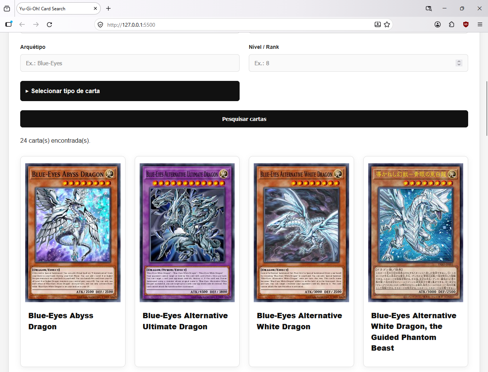
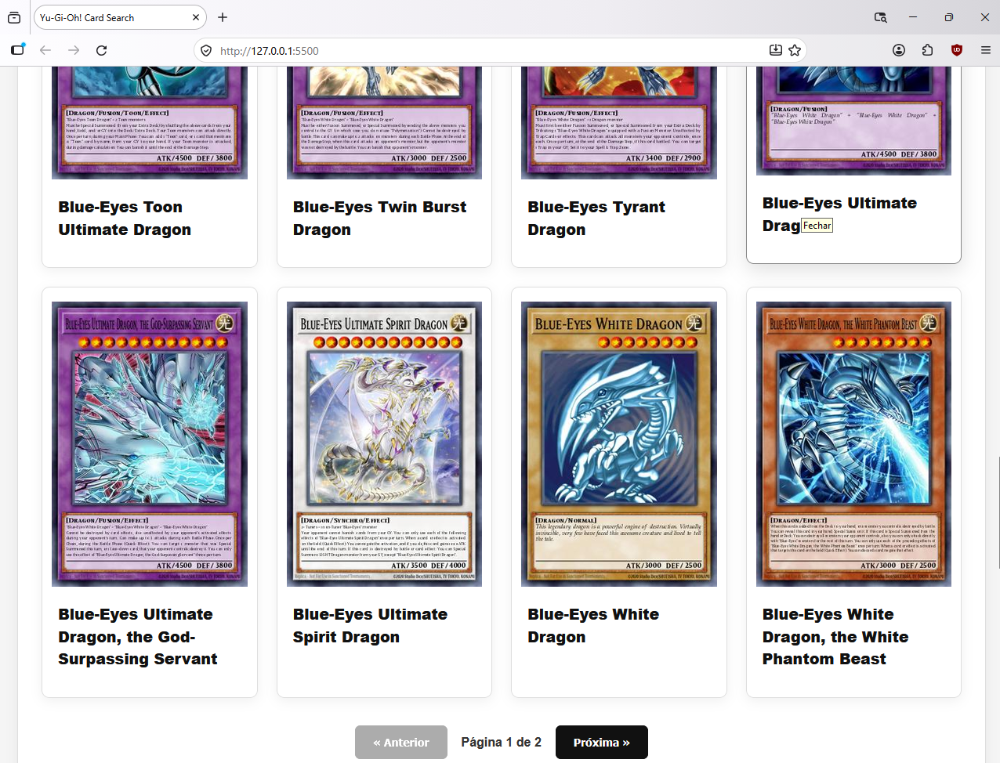

# DuelIndex
Plataforma para consulta, comparação e acompanhamento histórico
dos preços de cartas de yu-gi-oh.

## Funcionalidades

- Consulta de preços em diferentes plataformas.
- Gráficos de valorização e desvalorização.

## Demonstração

### Página inicial

### Consulta de cartas

### Histórico de preços

## Instruções de instalação
-baixe/clone o repositório
-verifique se as dependências do Flask,flask request e flask cors estão instaladas.
-rode o arquivo api_rest.py.
-rode a pagina localmente.
